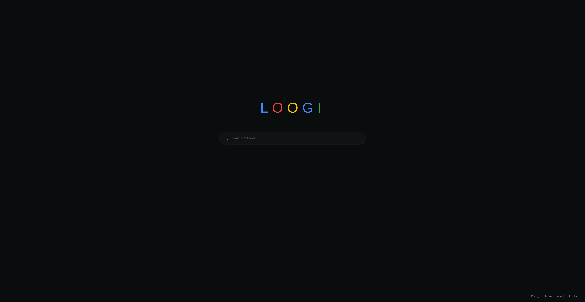

# LOOGI

A privacy-focused web search engine — running in production at [**loogi.ch**](https://loogi.ch). Built on top of [SearXNG](https://github.com/searxng/searxng), with a hardcoded LOOGI theme, a curated engine list, and a few operational refinements.

[](LICENSE)
[](https://github.com/searxng/searxng)
[](https://github.com/psimaker/homelab)

<p align="center">
  <a href="https://loogi.ch"></a>
</p>

## What this is

LOOGI is a single-purpose deployment of [SearXNG](https://github.com/searxng/searxng) — same engine, same template machinery, same Python runtime. What makes it LOOGI:

- one fixed visual identity (a `loogi/` Jinja theme with an OKLCH palette, no theme switching, no upstream-default rendering)
- a curated engine list that's actually maintained — see [ADR 0006](docs/adr/0006-engine-auswahl-praezision.md), [ADR 0015](docs/adr/0015-wikipedia-aus-general-engines-entfernen.md), [ADR 0016](docs/adr/0016-defekte-engines-und-brave-api.md) for the latest cleanups
- legal pages (privacy + terms) in five locales, surfaced via a small Dockerfile patch — see [ADR 0011](docs/adr/0011-legal-pages-via-infopage-patch.md)
- self-hosted-friendly defaults: NPM-aware trusted proxies, no public ports ([ADR 0008](docs/adr/0008-keine-ports-exposed-via-npm.md)), build-time config baking ([ADR 0003](docs/adr/0003-eigenes-docker-image-statt-volume-mounts.md))

This repo is the source. Deployment is part of my [homelab](https://github.com/psimaker/homelab) — currently Docker Compose, migrating to Kubernetes via Flux as the platform tier comes online.

## Architecture in one sentence

A custom Docker image (`FROM searxng/searxng:latest`) that bakes the LOOGI Jinja theme and a curated `settings.yml` into the layer; Compose orchestrates `searxng` + `valkey` (limiter cache); TLS and routing handled externally by Nginx Proxy Manager.

The "why" behind every non-trivial decision lives in [`docs/adr/`](docs/adr/README.md) — 16 ADRs in MADR format, **written in German**.

## Setup

Prerequisites:

- Docker + `docker compose` v2
- An external Docker bridge network named `proxy-net` (Nginx Proxy Manager creates it; or `docker network create proxy-net`)
- An external network `loogi-net` with subnet `172.30.0.0/24` ([ADR 0012](docs/adr/0012-bypass-netz-fuer-lokale-clients.md)):
  ```sh
  docker network create --subnet=172.30.0.0/24 loogi-net
  ```

```sh
cp .env.example .env
echo "SEARXNG_SECRET=$(openssl rand -hex 32)" >> .env
# optional: BRAVE_API_KEY=... (see ADR 0016) to enable the Brave Search API engine
docker compose build
docker compose up -d
```

## Local consumers (crawl4ai etc.)

Other stacks on the same host that want LOOGI as a search backend attach to `loogi-net` — they bypass bot-detection and rate-limits via `pass_ip` in `searxng/limiter.toml`:

```yaml
# crawl4ai/compose.yml
services:
  crawl4ai:
    # ...
    networks:
      - default
      - loogi-net      # http://loogi:8080 reachable, unlimited

networks:
  loogi-net:
    external: true
```

JSON API from the consumer:

```
http://loogi:8080/search?q=test&format=json
```

## Nginx Proxy Manager configuration

| Field | Value |
|---|---|
| Domain Names | `loogi.ch` |
| Scheme | `http` |
| Forward Host | `loogi` |
| Forward Port | `8080` |
| Block Common Exploits | enabled |
| Websockets | not required |

Under *Custom locations / Advanced*: pass through `X-Forwarded-For`, `X-Forwarded-Proto`, `X-Real-IP` — otherwise the rate-limiter only sees the proxy's IP.

SSL tab: Let's Encrypt, *Force SSL*, *HTTP/2*, *HSTS* — all on.

## Updates

```sh
docker compose pull         # pulls latest searxng/searxng
docker compose build        # bakes the LOOGI theme + config on top
docker compose up -d
```

On SearXNG major upgrades: diff the upstream default `settings.yml` and `searx/templates/simple/` against ours — new variables or required templates may have landed. See [ADR 0002](docs/adr/0002-design-hardcoded-via-eigenes-theme.md) and [ADR 0009](docs/adr/0009-config-deep-merge-statt-vollersatz.md).

## Repository layout

```
.
├── Dockerfile             # FROM searxng/searxng + COPY theme + config + sed-patches
├── compose.yml            # searxng + valkey, proxy-net + loogi-net + loogi-internal
├── searxng/
│   ├── settings.yml       # use_default_settings + LOOGI deltas
│   ├── limiter.toml       # trusted_proxies, link_token
│   └── infopage/          # privacy + terms in EN/DE/FR/ES/IT
├── theme/loogi/
│   ├── templates/         # Jinja templates → /usr/local/searxng/searx/templates/loogi/
│   └── static/            # CSS, JS, images → /usr/local/searxng/searx/static/themes/loogi/
└── docs/adr/              # 16 architecture decisions (MADR, German)
```

## Documentation

Architecture Decision Records (ADRs) live in [`docs/adr/`](docs/adr/) — German, MADR format. They cover SearXNG selection, the bake-into-image pattern, theme strategy, engine curation (with rationale for which engines were dropped and when), legal pages, the bypass-network for local consumers, and the mobile layout.

If you don't read German and want a summary of any specific ADR, open an issue.

## Acknowledgements

LOOGI builds on the work of others:

- **[SearXNG](https://github.com/searxng/searxng)** — the upstream meta-search engine. LOOGI extends it; everything searchable here works because SearXNG works.
- The LOOGI theme is **derived from SearXNG's `simple/` theme**: same template variables, ported macros, custom CSS/JS, hardcoded layout. AGPL-3.0-or-later applies to the derived work.
- **[Valkey](https://valkey.io/)** as the limiter cache backend — open-source Redis fork.

## Legal disclaimer

Privacy and Terms pages are reachable at `/info/<lang>/privacy` and `/info/<lang>/terms` (EN/DE/FR/ES/IT). Markdown sources in `searxng/infopage/<lang>/`.

> The texts in `privacy.md` and `terms.md` have **not** been reviewed by a lawyer. Before launching publicly, anyone running this code should have them reviewed in their jurisdiction (Swiss DSG / EU GDPR / etc.).

## License

[AGPL-3.0-or-later](LICENSE) — inherited from SearXNG. Any public modification must be released under the same license. The source for the running loogi.ch instance is this repository.
